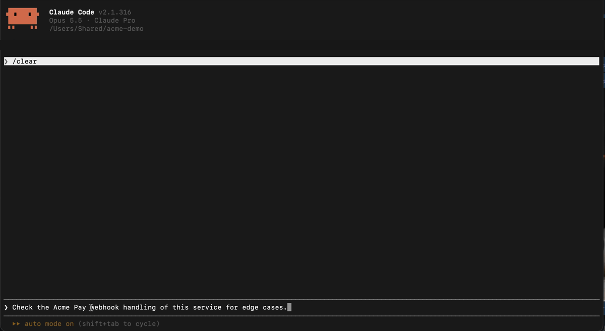

# TwinStub for Claude Code

Claude writes your webhook handler. TwinStub lets it test the cases a
provider sandbox won't give you on cue: the same event delivered twice,
`completed` arriving before `pending`, a bad or missing signature, a
chargeback 30 days later, a retry after your handler returned 503.

The plugin adds 13 tools and a skill. The skill has Claude write the
expected end state for each event order first, run it against TwinStub,
and check your app's state, not just the 200s. Works with any provider:
you describe it as a stateful scenario in YAML.



In the demo, Claude checks a subscription service where every webhook got
a 200 and finds four failing cases, including an out-of-order delivery
that happened on its own after a 503 and a retry. The service is
[examples/agent-demo](https://github.com/twinstub/twinstub/tree/main/examples/agent-demo);
the recording is sped up 3x.

## Requirements

- [TwinStub](https://github.com/twinstub/twinstub) 1.1.2 or later, with
  the `twinstub` binary on your PATH.
- Claude Code. The tools run locally; they are not available in Claude chat.

## Install

1. Install TwinStub. Download a binary from the
   [releases page](https://github.com/twinstub/twinstub/releases) and put
   it on your PATH, or build it with Go:

   ```sh
   go install github.com/twinstub/twinstub/cmd/twinstub@latest
   ```

   `twinstub version` should print 1.1.2 or later. `go install` puts the
   binary in `$(go env GOPATH)/bin`, which is often not on PATH. If
   `/mcp` in Claude Code shows the twinstub server as failed with
   `Executable not found in $PATH: "stdio"`, that is the reason: for
   plugin servers Claude Code prints `stdio` in place of the command name.
   Put `twinstub` on the PATH that Claude Code starts with and restart it.

2. Add the plugin in Claude Code:

   ```
   /plugin marketplace add twinstub/claude-plugin
   /plugin install twinstub@twinstub
   ```

## What this plugin runs and sends

- Runs `twinstub mcp` from your PATH as a local MCP server. It runs no
  shell commands and starts no engine until Claude calls a TwinStub tool.
- On the first tool call it connects to an engine you already run
  (`twinstub serve` on localhost:9090, or the address you set with
  `--admin-url` or `TWINSTUB_ADMIN_URL`), or starts one in the same
  process. An engine it starts listens on this machine only: the port
  your app calls (8080 by default) on 127.0.0.1 and ::1, its admin API on
  127.0.0.1.
- The engine sends HTTP requests only to the webhook target URLs written
  in your scenario files, normally your app on localhost.
- It reads `twinstub.yaml` in the project directory, or the config file
  Claude or you pass to it, the files that config includes, and the
  environment variables it references. `twinstub_validate_config` with
  inline YAML writes it to a temporary file and deletes it right after.
- Sessions, the delivery journal and the 404 log live in memory only and
  are gone after `twinstub_reset` or when the server stops. Nothing else
  is written to disk.
- No telemetry and no update checks. Nothing is sent to the TwinStub
  authors or any third party.

See also [PRIVACY.md](PRIVACY.md).

### Without the binary: Docker

Run the engine with Docker and use the server definition in
[extras/docker.mcp.json](extras/docker.mcp.json): copy it into your
project's `.mcp.json` instead of installing the plugin's server. Docker
pulls the `ghcr.io/twinstub/twinstub` image from GitHub's registry.

```sh
docker run --rm -v "$PWD:/work" -p 8080:8080 -p 9090:9090 ghcr.io/twinstub/twinstub:1.1.2 serve
```

The MCP server in the container reaches that engine through
`host.docker.internal`.

## Try it

Ask Claude something like:

> Write a webhook handler for Acme Pay payment events in this service and
> test duplicate and out-of-order delivery with TwinStub.

Claude models the provider in a scenario, writes a table of "events in
this order, expected state of our app", then delivers events out of order,
redelivers them, breaks signatures and moves time forward, and checks what
your app did.

## Tools

| Tool | What it does |
|---|---|
| `twinstub_status` | which engine is used and the port your app must call |
| `twinstub_list_scenarios` | states, rules, webhooks, delays, targets |
| `twinstub_validate_config` / `twinstub_load_config` | check and load scenario YAML |
| `twinstub_start_session` / `twinstub_get_session` | start a session, read its state and history |
| `twinstub_trigger` | move a session to a state |
| `twinstub_deliver` | send queued webhooks now, in a chosen order |
| `twinstub_advance_time` | move a session's clock forward, `30d` included |
| `twinstub_list_deliveries` | what was sent and how your app answered |
| `twinstub_replay_delivery` | resend: `redeliver`, `duplicate`, `bad_signature`, `no_signature`, `as_is` |
| `twinstub_explain_miss` | why a request to TwinStub got a 404 |
| `twinstub_reset` | clean slate between test runs |

Details: [docs/mcp.md](https://github.com/twinstub/twinstub/blob/main/docs/mcp.md).

## Good to know

- `twinstub_advance_time` moves TwinStub's clock, not your app's. If your
  app has its own time rules (refund windows, expiry), they need an
  injectable clock to be tested the same way.
- A scenario is only as accurate as what you write in it. Check response
  shapes against the provider's documentation once.
- An app in a container or on another machine cannot reach the engine
  the plugin starts. Run `twinstub serve` for it instead; that engine
  listens on all interfaces.
- Plugin version 1.1.2 expects twinstub 1.1.2 or newer. Older versions
  work, but 1.1.0 starts an engine in every Claude Code session and both
  1.1.0 and 1.1.1 listen on all interfaces. `twinstub_status` reports an
  engine older than 1.1.0.

## License

MIT, like the engine. Both are free to use, including commercially. See
[LICENSE](LICENSE).
